# Pluma de grúa en caída libre con gancho

Simulación numérica para la asignatura Mecánica y Ondas I.

Una pluma de grúa homogénea y rígida (masa `M`, longitud `L`) se desprende de la barra lateral y cae en un plano vertical. Del punto medio de la pluma cuelga un gancho (masa `m`) con un cable inextensible de longitud `l`. El planteamiento del problema, el modelo y su resolución analítica están en el informe que acompaña a este código.

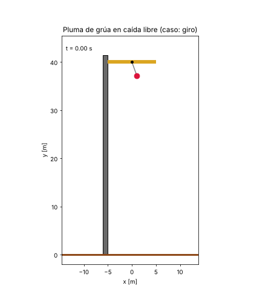

## Qué hace el programa

Integra numéricamente las ecuaciones de Euler-Lagrange del sistema (`scipy.integrate.solve_ivp`, `rtol=1e-10`), sin usar la solución analítica, y comprueba que:

- se conservan `p_x`, `p_alpha` y la energía `E`,
- el resultado coincide con la solución analítica del apartado c) del informe,
- el cable no se afloja (`T ≥ 0`).

La simulación termina cuando el punto más bajo del sistema toca el suelo. `H` es la altura inicial de la pluma sobre el suelo. En las animaciones se dibuja la torre de la que se desprende la pluma, solo como decoración.

## Resultados del caso principal

Las gráficas siguientes corresponden al caso `giro`, en el que la pluma y el cable tienen velocidad angular inicial. La simulación termina a los 2,7 s aproximadamente.

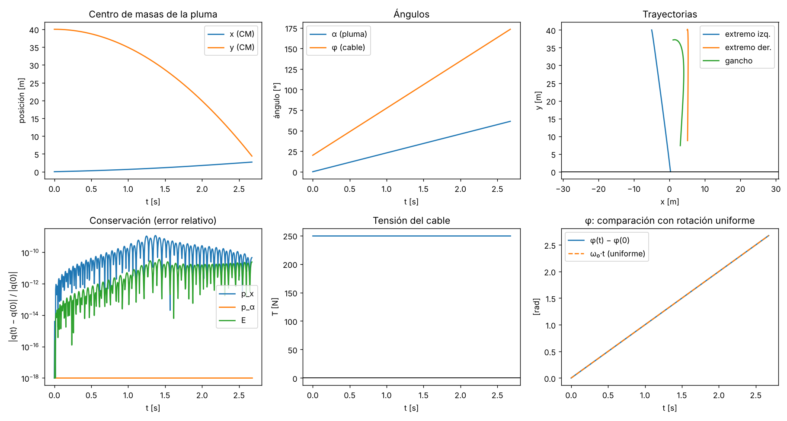

- **Centro de masas de la pluma:** `y` baja de 40 m a unos 4 m siguiendo una parábola, como corresponde a una caída libre, mientras que `x` apenas cambia (unos 3 m en total).
- **Ángulos:** tanto el ángulo de la pluma `alpha` como el del cable `phi` crecen de forma lineal con el tiempo, es decir, giran con velocidad angular constante.
- **Trayectorias:** recorrido de los dos extremos de la pluma y del gancho desde la posición inicial hasta que el sistema llega al suelo.
- **Conservación (error relativo):** muestra cuánto se aleja cada cantidad de su valor inicial, en escala logarítmica. `p_x` y `E` varían menos de 1e-9 en términos relativos, y `p_alpha` no varía nada (la línea de abajo del todo es solo el valor mínimo que se suma para poder dibujar el logaritmo).
- **Tensión del cable:** es constante, unos 250 N, y positiva, así que el cable no se afloja en ningún momento. Coincide con `M·m/(M+m)·l·phid²`.
- **`phi` frente a rotación uniforme:** el `phi(t) − phi(0)` de la simulación (línea continua) se superpone con `ω₀·t` (línea discontinua), que es lo que predice la solución analítica.

## Otros casos

Estos son algunos de los casos que se pueden simular cambiando las condiciones iniciales o los parámetros. Hay más en las carpetas `animaciones/` y `graficas/`.

### Caso `luna` (g = 1,62 m/s²)

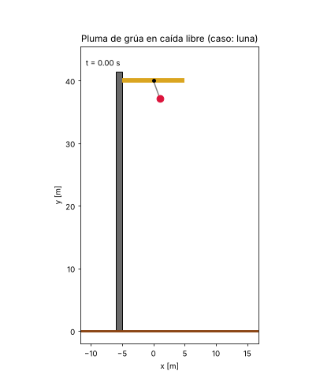
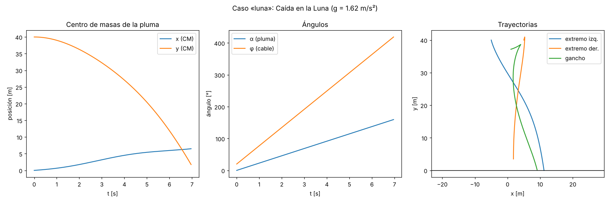

### Caso `tiro_oblicuo` (vx0 = 6 m/s, vy0 = 8 m/s)

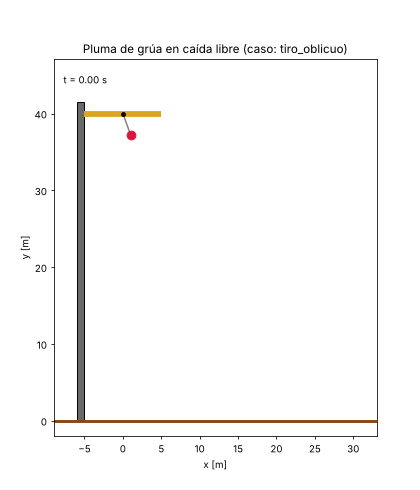
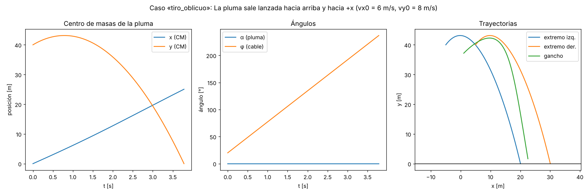

### Caso `giro_rapido` (el cable gira a 8 rad/s)
Este es un caso límite

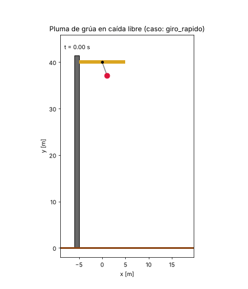
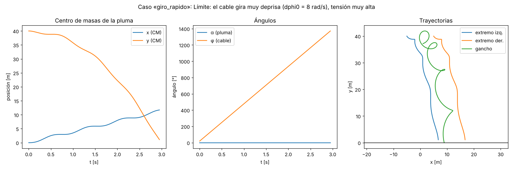

### Caso `pluma_larga` (L = 30 m)

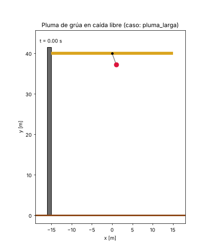
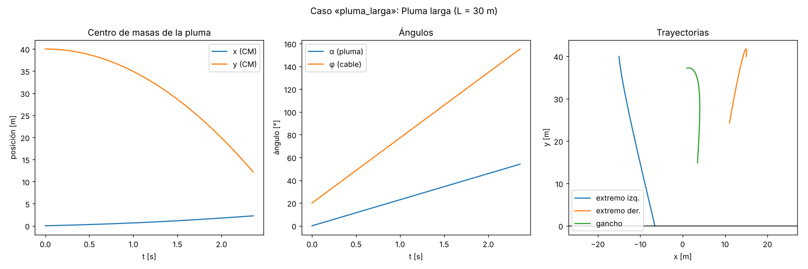

### Caso `altura_baja` (H = 10 m)

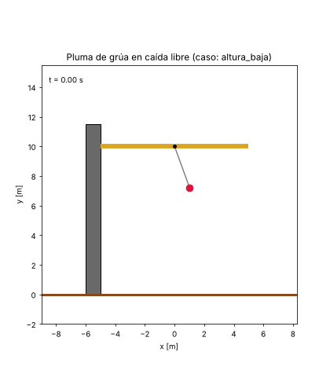
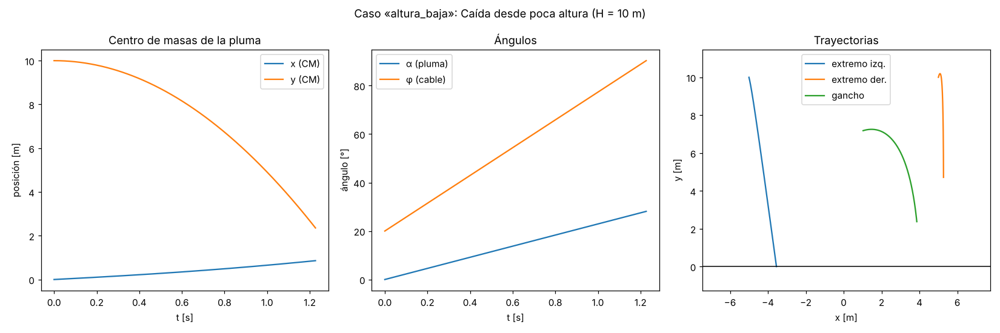

## Cómo ejecutarlo

Hace falta Python. Desde la carpeta del proyecto:

```bash
pip install -r requirements.txt
python simulacion.py
```

Se generan `resultados.png` y `animacion.gif` (caso principal) y las carpetas `animaciones/` y `graficas/` con todos los casos. Los parámetros base (`M`, `m`, `L`, `l`, `H`, `g`) están en `PARAMS_BASE`, y los casos en el diccionario `CASOS`, al principio de `simulacion.py`. Para añadir un caso nuevo basta con copiar una entrada de `CASOS` y cambiar las condiciones iniciales (`ci`) o los parámetros (`params`).
